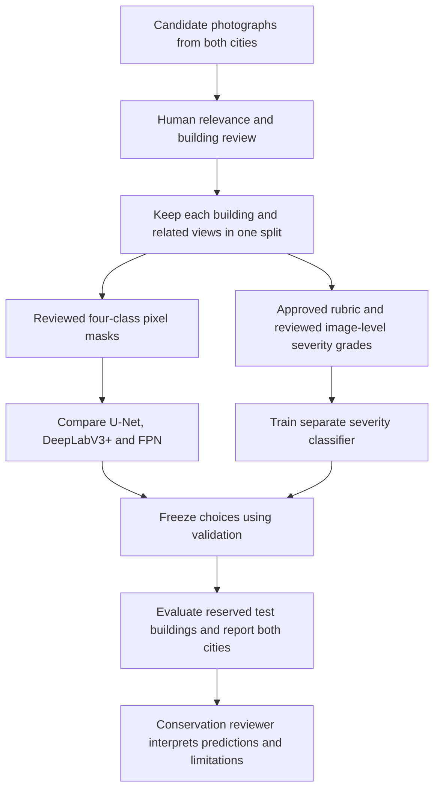

# Project scope, four parts and completion goals

**Purpose:** help a conservation reviewer locate visible deterioration in photographs of historical structures in Erbil and Amedi, compare methods, and organize further inspection. The research title is **Semantic Segmentation and Damage Severity Classification of Historical Citadel Structures in Erbil and Amedi using Deep Convolutional Neural Networks**.

The repository currently contains a trained **binary crack prototype** and tested software for the broader study. The broader research is incomplete: no approved four-class target dataset, approved severity rubric, or trained/evaluated target severity model is available. A photograph cannot establish structural safety, hidden damage, physical wall area or calibrated crack width.

Start at the [repository guide](../README.md) for installation and access to assets. Read [Method and prediction](METHOD_AND_PREDICTION.md) for parameters, equations and the exact prediction process, and [the complete workflow](../ALL_FOUR_PARTS.md) for commands.

## The four project parts

These are four **workstreams**, not four output labels.

| Part | Question it answers | Main implementation | Completion evidence still needed |
|---|---|---|---|
| 1. Semantic segmentation | Where is each visible surface category in a photograph? | [Four-class training](../train_four_class.py), [four-class prediction](../predict_four_class.py) | Reviewed pixel masks, real target-domain training and held-out per-class Dice/IoU and mean IoU |
| 2. Visual damage severity | Which approved visible-severity grade describes the photograph? | [Severity pipeline](../severity_pipeline.py) | Approved rubric, independently reviewed image-level grades, a trained model, confusion matrix, macro F1 and ordinal error |
| 3. Erbil and Amedi data | Does the method work on reviewed photographs from both target locations? | [Two-site review preparation](../prepare_two_site_review.py), source manifests and data validation | Verified location/building identity, relevant photographs, adequate class/grade coverage and separate buildings in each split |
| 4. Deep CNN comparison | Which segmentation architecture works best under the same experimental conditions? | U-Net, DeepLabV3+ and FPN in [the shared trainer](../train_four_class.py) | Comparable reviewed-data runs, validation-based selection, frozen choices and final test results reported by site |

The two-city part defines the study population and evaluation coverage. The architecture-comparison part evaluates alternative methods for the segmentation task. They are not extra classes predicted at each pixel.

## The four segmentation classes

These are mutually exclusive pixel IDs within the reviewed task surface. The severity classifier has a different label system.

| Pixel ID | Displayed meaning | Annotation issue to resolve consistently |
|---:|---|---|
| 0 | Healthy masonry | Visibly intact, assessable masonry; unlabeled pixels are not automatically healthy |
| 1 | Visible crack | Distinguish fissures from construction joints, mortar gaps, shadows and decorative openings |
| 2 | Surface erosion | Define visible surface loss and boundaries consistently with the reviewer |
| 3 | Vegetation overgrowth | Define vegetation on/over the relevant surface; agree how occluded masonry is treated |
| 255 | Ignore / outside the task | Unreviewed or ambiguous pixels, excluded background, or area outside a supplied inference ROI |

`Structural Crack` remains the legacy class name in the training code and protocol for compatibility. The inference display says **Visible crack** because a visual label alone does not establish structural significance. See [four-class inference](../FOUR_CLASS_INFERENCE.md) and [the annotation/data review guidance](../TWO_SITE_DATA_REVIEW.md).

The earlier binary pilot uses a separate encoding: **0 intact/non-crack, 1 crack, 255 unreviewed/ignore** in training masks. Its exported prediction PNG uses **0 non-crack and 255 predicted crack**. Therefore, a binary prediction PNG must never be treated as an approved training mask or a four-class mask.

## What the project has now

Snapshot: 18 October 2026. These figures describe recorded local evidence, not a new evaluation.

| Asset/evidence | Current state |
|---|---|
| Candidate photographs | 800 downloaded image versions, with collection labels of 609 Erbil and 191 Amedi; integrity checked |
| Candidate suitability | Requires human relevance, site/building and resolution review; collection membership does not prove a usable heritage-building image |
| Reviewed binary target data | Sparse selections through region 333 on three Erbil photographs: 0650, 0450 and 0750 |
| Reviewed pixels | 177,493 total: 165,275 intact and 12,218 crack; other pixels are ignored |
| Best binary target development result | 69.23% pooled crack Dice; 52.94% IoU; 95.94% precision; 54.16% recall |
| Approved four-class target rows found in the documented audit | 0 |
| Reviewed image-level severity labels in the existing reviewed-photo records | 0 |
| Severity rubric | Pending draft; the lecturer has not supplied an approved rubric |
| Four-class/severity software | Implemented and tested with temporary synthetic fixtures; those tests do not establish research accuracy |

The binary score comes from three whole-photo holdout folds, but the same photographs were repeatedly inspected and reused to choose methods. It is **development evidence**, not an independent final test. All three photographs are from Erbil Citadel, and building overlap is not fully verified. No Amedi, four-class or severity performance follows from that score. The final model trained on all three photographs has no independent test score of its own.

The **80% aspiration is not achieved**. For the current binary prototype, the reported target metric is crack Dice, rather than raw pixel accuracy. A model predicting intact everywhere would already achieve about 93.1% pixel accuracy on the selected labels. Agree separate evaluation criteria for the four-class and severity tasks before interpreting any future “80%” claim. See the [full improvement comparison](../REVIEWED_IMPROVEMENT_RESULTS.md).

## What each kind of file means

| File category | Role | What it does not establish |
|---|---|---|
| Original/candidate photograph and source record | Input image, author/license/source attribution, file identity and collection metadata | Relevance, correct building grouping or damage labels |
| Human-reviewed mask | Pixel-level reference labels at the source dimensions | An image-level severity grade, structural safety or complete coverage if many pixels remain ignored |
| Reviewed severity record and approved rubric | Reference image-level grade with a documented meaning and reviewer | A segmentation mask or physical damage measurement |
| Manifest and protocol | Connect files, hashes, groups, splits, settings and review provenance | The truth of a human approval claim merely because a field says approved |
| Model checkpoint | Learned numerical weights for a particular architecture/task | Accuracy on new photographs without a suitable evaluation |
| Prediction mask, overlay or probability file | A model's output for review | Ground truth, an accepted annotation or a calibrated confidence guarantee |
| Metrics and report | Results on a stated reference dataset, with its limitations | General performance beyond the evaluated data and task |

The candidate images are sourced with individual credits, primarily through Wikimedia Commons records. They are not an official UNESCO-labeled machine-learning dataset. Preserve source-specific attribution and license records when distributing photographs or derived views. See [dataset documentation](../DATASET.md), [source records](../PHOTO_SOURCES.md) and [the inventory audit](../TWO_SITE_DATA_REVIEW.md).

## A realistic real-world use

A reviewer can supply a clear masonry photograph and a region selecting the relevant surface. Once an appropriate four-class model has been trained and evaluated, its overlay can help locate crack, erosion and vegetation candidates for inspection. A separately evaluated severity classifier can propose a grade defined by the approved rubric. The reviewer confirms or corrects the outputs and decides whether more evidence or an on-site inspection is needed.

Possible research applications include indexing a photographic survey, finding surfaces that warrant closer review, comparing prediction errors across buildings and cities, and studying which CNN architecture handles local materials best. The current prototype does not replace a conservation specialist or a structural assessment. Comparing dated photographs would additionally require comparable framing, registration and a validated change-detection method; the repository does not currently establish that capability.

## Completion checklist and how to help

1. **Resolve the dataset requirement.** Confirm with the supervisor whether the 800 downloaded image versions meet the required resolution, relevance and independence criteria. Replace unsuitable views where needed; 800 files are not automatically 800 suitable annotated examples.
2. **Review source photographs and building identity.** Use the [pending two-site pack](../TWO_SITE_DATA_REVIEW.md). Related views, crops and near duplicates must stay in the same building group and split. Leave uncertain identity pending.
3. **Agree the annotation rules and draw four-class masks.** Review complete task surfaces, including difficult non-crack areas such as joints and shadows. Record annotator and independent reviewer; preserve ignored pixels where uncertain.
4. **Approve the severity rubric, then label severity independently.** Discuss the [pending draft](../severity-rubric-draft.json) with the supervisor or an authorized reviewer. Do not derive low/moderate/high from an uncalibrated predicted pixel percentage. Follow the [severity workflow](../SEVERITY_WORKFLOW.md).
5. **Freeze grouped splits and audit coverage.** Both cities must appear in each train/validation/test split in the project workflow. Check class and severity supports, not only total image counts. Reserve different buildings for the final test.
6. **Run comparable experiments and report real findings.** Use the same reviewed data, preprocessing, seed policy and training budget across the three segmentation architectures. Select using validation, freeze decisions, then evaluate the held-out test and report both cities, failed cases and uncertainty.
7. **Update the research report and demonstration.** Include source/licensing records, methods, parameter settings, exact metrics and limitations. A runnable program and passing software tests are necessary engineering evidence, but they do not complete the scientific study.

The [completion plan](../COMPLETION_PLAN.md) and [four-part delivery record](../FOUR_PART_PROGRESS.md) preserve the distinction between software readiness and the research evidence still required.
